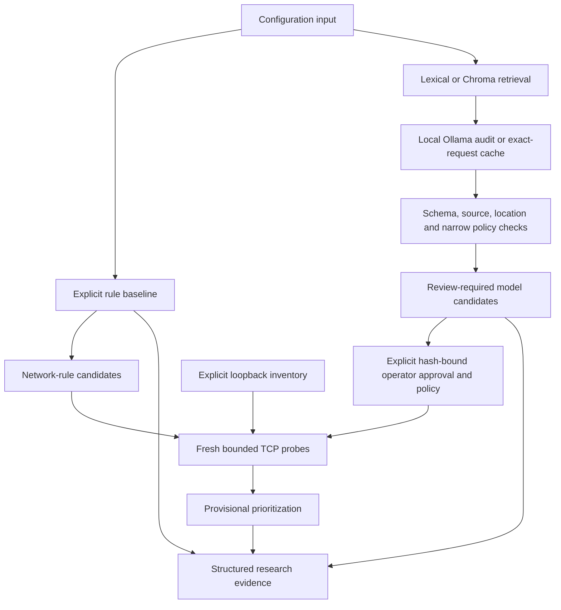

<div align="center">

# Active Cloud Guard

### Evidence-linked configuration auditing for cloud-hosted open-source software

Honors research · Engine 1 v2.2 · Engine 2 replay foundation · Package 0.5.0

[Research protocol](docs/EXPERIMENT_PROTOCOL.md) · [Architecture](docs/ARCHITECTURE.md) · [Evidence](docs/EVIDENCE.md) · [Documentation](docs/INDEX.md)

</div>

---

## Abstract

Active Cloud Guard investigates how configuration analysis, retrieval-assisted local language models, and controlled network observations can support security review of cloud-hosted open-source software. The prototype separates three concepts: a configuration-level candidate, observed reachability from a specified vantage point, and an actionable vulnerability.

The implementation combines a transparent rule baseline, source-backed retrieval, structured local-model auditing, and explicit staging probes. Engine 1 v2 adds bounded response reuse, reusable vector indexing, generation controls, and stage-level timing. This repository includes development fixtures, reproducibility scripts, raw observations, negative model results, and a documented evaluation protocol.

V2.1 adds hash-bound operator policies and reviewed model-to-endpoint verification. Approved candidates receive scoped TCP evidence—not automatic vulnerability confirmation or scoring. Read the [refinement report and operator workflow](docs/ENGINE1_REFINEMENT.md).

V2.2 adds actual-Compose local deployment identity checks and credential-free Redis/PostgreSQL observations. Both were exercised against the existing loopback lab. See the [baseline report, commands and limitations](docs/ENGINE1_BASELINE.md).

Engine 1 is preserved under Git tag `engine1-v2.2`. Engine 2 has begun with an **observation-only replay foundation**: normalized events, time-window features and a simple statistical comparator. Its demonstration is synthetic, not live telemetry or validated ML. See the [Engine 2 report](docs/ENGINE2_FOUNDATION.md).

**Research status:** implemented, software-tested and live-smoke-observed. Independent effectiveness evaluation remains pending. This is a research prototype—not a production security control or a claim of validated vulnerability prevention.

| Project | Details |
|---|---|
| Researcher | Manish Patil |
| Proposal | *An Active AI Security Layer for Misconfiguration & Exposure Prevention in Cloud-Hosted Open-Source Software* |
| Current scope | Frozen Engine 1 baseline and initial observation-only Engine 2 replay |
| Execution | Local Python CLI/library; Docker Compose, Ollama and Chroma |
| Evidence snapshot | 25 September 2026; 196 passing software tests; live Engine 1 observations remain dated 23 September |
| Evaluation data | 45 synthetic development cases; **not an independent test set** |

## Research questions

1. **Retrieved context:** does security-context retrieval improve finding-level precision and recall relative to the same local model without retrieval?
2. **Verification:** can scoped verification improve prioritization without concealing false negatives or unsupported conclusions?
3. **Runtime evidence, later work:** what additional value and overhead would runtime observations provide?

These are questions to be evaluated, not established results. The [experimental protocol](docs/EXPERIMENT_PROTOCOL.md) defines independent annotation, grouped data separation, matched comparisons, abstention handling and uncertainty reporting. The [literature audit](docs/LITERATURE.md) distinguishes verified sources from references requiring further review.

## System architecture



Model candidates remain separate from rule findings. They do not execute commands, choose probe destinations, or automatically trigger remediation. A TCP connection is reachability evidence, not proof of authentication bypass or Internet exposure. See the [architecture](docs/ARCHITECTURE.md) and [security boundaries](docs/SECURITY.md).

### Implemented capabilities

| Component | Present implementation | Boundary |
|---|---|---|
| Configuration baseline | Nine explicit predicates across selected Compose, Kubernetes, Terraform, Dockerfile and service-configuration constructs | Not a general IaC evaluator |
| Knowledge retrieval | Nine summaries with official-source provenance; lexical and Chroma retrieval | Source membership does not establish entailment |
| Local-model auditing | Ollama, structured JSON, exact-location checks and two narrow authentication-policy guards | All candidates require human review |
| Active verification | Loopback TCP plus identity-gated Redis PING/PostgreSQL startup | No supplied credentials, data access, exploitability or public-exposure validation |
| Prioritization | Monotonic provisional scoring; missing evidence remains explicit | Weights are not empirically calibrated |
| V2 efficiency | Opt-in exact-request cache, index reuse, generation limits and stage timings | Repeat-work optimization, not demonstrated energy savings |

The local testbed contains Redis, PostgreSQL, Nginx and MinIO, with Ollama as the model service. Engine 2 currently supports replay-based count deviations only. Live eBPF/Kubernetes collection, trained runtime ML, autonomous isolation and production deployment are not implemented.

## Results and evidence

### Software and integration evidence

| Observation | Evidence | Interpretation |
|---|---|---|
| 196 passing software tests | [Current test report](output/engine2-foundation-tests.xml) | Regression checks; not detection accuracy |
| Engine 2 constructed count deviation | [Synthetic replay report](output/engine2-replay-smoke.json) | No live sensor or independent threat labels |
| Stable identity and service observations | [V2.2 live lab report](output/service-identity-v22-final.json) | Redis protected-mode denial and PostgreSQL SASL challenge; no full attestation |
| Policy-aware real loopback observations | [V2.1 smoke report](output/verification-v21-smoke.json) | Synthetic policies and accept-only listener; no deployment or model claim |
| 45 development fixtures matched expected rule sets | [Development baseline](output/baseline-development.json) | Seeded-predicate coverage, not generalization |
| Four local TCP accepts and two HTTP 200 responses | [Historical lab observation](output/live-testbed.json) | Time- and vantage-specific availability |
| Vector retrieval and integrated model/probe execution | [Vector smoke](output/vector-smoke.json), [integrated run](output/integrated-demo.json) | Historical functional observations |
| Trivy executed on 11 compatible fixtures; 34 excluded | [Trivy baseline](output/trivy-baseline.json) | Different policy coverage; not a head-to-head accuracy result |

### Engine 1 v2: repeat-work efficiency

These measurements come from **one development fixture**, executed sequentially on the recorded Windows environment with `qwen2.5:3b` and `nomic-embed-text`. Pipeline runs used lexical retrieval; index timings are separate operations.

| Operation | Observed wall time | Work performed |
|---|---:|---|
| Forced vector-index build | 5.804 s | Nine documents embedded |
| Unchanged index reuse | 0.084 s | Zero documents embedded |
| First uncached pipeline | 17.424 s | Fresh generation and TCP probe |
| Warm cache-miss pipeline | 5.256 s | Fresh generation and TCP probe |
| Cache-hit pipeline, repeat 1 | 0.084 s | Revalidated cached output; fresh TCP probe |
| Cache-hit pipeline, repeat 2 | 0.072 s | Revalidated cached output; fresh TCP probe |

Source: [raw v2 observation](output/v2-efficiency-smoke.json). Conditions, identities and metric semantics: [Engine 1 v2 design](docs/ENGINE1_V2.md).

Cached candidates were preserved and probes received new timestamps. These observations establish functional reuse on this input; they do **not** establish a latency distribution, a matched v1 improvement, or energy/carbon savings. The 3.5-second uncached inference target remains unmet.

### Negative results and validity limits

- **Model reliability:** earlier runs produced malformed output and unsupported claims. Both [initial failures](output/rag-smoke-initial-failures.json) and [unsupported candidates](output/rag-smoke-ungrounded-candidates.json) are retained.
- **Limited guards:** the 3B model inferred trust authentication from a password placeholder. The [pre-guard observation](output/rag-smoke-3b-before-policy-guard.json) remains available. Narrow guards mitigate known predicates; hallucinations are not generally solved.
- **Data leakage risk:** prompts and model choices were tuned on development cases. These cases cannot subsequently be described as untouched evaluation data.
- **Coverage:** no general Terraform evaluation, Helm rendering, comprehensive secret detection or role-binding graph is implemented. Unsupported cases must not disappear from evaluation denominators.
- **External validity:** no independently labeled effectiveness study, calibrated prioritization, production-safety assessment or Linux runtime validation is claimed.

An empty candidate list is not a security certification. A rejected model candidate is an abstention, not a clean verdict. The [evidence index](docs/EVIDENCE.md) distinguishes current v2 artifacts from historical observations; the older [results ledger](output/RESEARCH_STATUS.md) is not a v2 summary.

## Reproducibility

### 1. Prepare the environment

Prerequisites: repository access, Python 3.11+, Git, and Docker with Linux-container support for live experiments. Model/image downloads require several GB. Recorded execution used Windows and Python 3.12.14; other platforms require separate validation.

From the repository root, create and activate an environment.

**Windows PowerShell**

```powershell
python -m venv .venv
.\.venv\Scripts\Activate.ps1
```

**Linux/macOS shell — setup guidance, not a validated run**

```bash
python3 -m venv .venv
source .venv/bin/activate
```

Then install the research package and enable the local publication guard:

```bash
python -m pip install -e ".[vector,test]"
git config core.hooksPath .githooks
```

For the captured Windows dependency versions, use `python -m pip install -r requirements-lock.txt` before the editable installation. The [lockfile](requirements-lock.txt) is an environment snapshot, not a guarantee of cross-platform resolution. The [historical environment report](output/environment.json) records earlier image/model identities; v2 model and corpus digests are in its raw observation.

### 2. Run software checks and a model-free scan

```bash
python -m pytest -q
python -m pip check
python -m cloudguard.cli scan data/development/postgres-trust.yaml
python -m cloudguard.cli retrieve "PostgreSQL trust authentication"
python scripts/repository_check.py
```

These commands do not require the live Docker lab. The 45 development fixtures are already versioned; rebuilding them is not required for a first inspection. Lint/format commands and experiment prerequisites are documented in the [test plan](docs/TEST_PLAN.md).

### 3. Start the controlled lab and local models

```bash
python scripts/init_secrets.py
docker compose -f testbed/compose.yaml --profile ai up -d
docker compose -f testbed/compose.yaml exec -T ollama ollama pull qwen2.5:3b
docker compose -f testbed/compose.yaml exec -T ollama ollama pull nomic-embed-text
python -m cloudguard.cli index
```

Model tags can resolve to different artifacts over time. Compare downloaded digests with the saved report before claiming matched reproduction. Pinned historical container versions support reproducibility; they are not a recommendation for production deployment.

### 4. Audit, verify and measure

```bash
python -m cloudguard.cli run data/development/redis-all.yaml --inventory testbed/inventory.json --model qwen2.5:3b --cache-dir output/audit-cache --max-tokens 512 --timeout 180
python -m cloudguard.cli probe --inventory testbed/inventory.json --asset compose/redis
python scripts/benchmark_v2.py --output output/v2-new-run.json
```

Repeat the `run` command to observe exact-request reuse. Omit `--cache-dir` for fresh generation; add `--vector-index output/chroma` for semantic retrieval. Use `index --force` to rebuild embeddings. The timeout is an HTTP socket timeout, not a total workflow deadline or guaranteed cancellation of server work.

The benchmark requires a **new output filename** and preserves partial observations on failure. Do not overwrite committed evidence. Older evaluation scripts may write fixed report paths; run them only in a separate experimental checkout or after explicitly arranging evidence preservation. Consult the [test plan](docs/TEST_PLAN.md) before reproducing historical experiments.

Stop the lab without deleting model volumes:

```bash
docker compose -f testbed/compose.yaml --profile ai stop
```

### Lab safety and data handling

All published ports bind to `127.0.0.1`: Redis `16379`, PostgreSQL `15432`, Nginx `18080`, MinIO `19000`, and Ollama `11434`. The dedicated bridge is **not egress-isolated**. Only use explicitly authorized local endpoints; intentionally weak fixtures are analysis inputs, not deployment recipes.

PostgreSQL/MinIO data are disposable; Redis persistence is disabled. Credentials, model weights, vector databases and audit caches are not committed. Generated cache content can repeat sensitive input: use a trusted local directory and preserve exclusions. See [security policy](docs/SECURITY.md) for the complete boundaries.

## Engine 2: observation-only replay

```bash
python -m cloudguard.cli runtime-replay data/runtime/observation-synthetic.json --baseline data/runtime/baseline-synthetic.json --inventory testbed/inventory.json
python scripts/runtime_check.py --output output/engine2-new-replay.json
```

This opens no network connection and executes no response action. The fixtures contain invented timestamps and a placeholder container ID. Missing windows remain unknown; deviations require review and are not attack probabilities. Live sensor integration, trusted identity mapping, independent runtime labels and ML comparison are next gates, not implied capabilities. Read the [contract and limitations](docs/ENGINE2_FOUNDATION.md).

## Repository guide

| Location | Purpose |
|---|---|
| [cloudguard/](cloudguard/) | Parser/rules, retrieval, local audit, cache, probes, scoring and CLI |
| [tests/](tests/) | Software regression and boundary checks |
| [data/](data/) | Synthetic development fixtures and labels |
| [knowledge/](knowledge/) | Source summaries and provenance |
| [testbed/](testbed/) | Docker lab and explicit endpoint inventory |
| [scripts/](scripts/) | Reproduction, measurement and publication checks |
| [output/](output/) | Reviewed observations, failures and test reports |
| [docs/](docs/INDEX.md) | Protocol, design, evidence, decisions and maintenance history |

## Research roadmap

The next scientific milestone is independent evaluation:

1. Obtain independent reviewer labels and an untouched, grouped evaluation set.
2. Run matched rule-baseline, local-model and retrieval-assisted comparisons with coverage and abstentions reported.
3. Evaluate evidence-linked prioritization, false negatives and uncertainty under an agreed threat model.
4. Measure unseen-input latency, CPU/memory and power before making broader efficiency or sustainability claims.
5. Extend the Engine 2 replay foundation with validated Linux sensor capture, coverage accounting and independently evaluated runtime models.

The [task ledger](TASKS.md) records completed engineering work, partial research work and deferred milestones. Engineering completion is not equivalent to validating the research hypothesis.

## Review, attribution and maintenance

For review, begin with the [protocol](docs/EXPERIMENT_PROTOCOL.md), [evidence index](docs/EVIDENCE.md), [decision register](docs/DECISIONS.md) and [incident ledger](docs/INCIDENTS.md). Changes follow the [documentation maintenance contract](docs/DOCUMENTATION_WORKFLOW.md): record what changed, why, exact checks, failures and remaining limits. The commit guard runs locally; no hosted CI result or peer-review endorsement is implied.

When referring to this software in an internal report, identify **Manish Patil, Active Cloud Guard, package version 0.5.0**, the exact Git commit and the specific evidence artifact used. This is software attribution guidance, not a publication citation; no DOI is claimed.

The repository is private. No open-source license has been selected; access does not itself grant redistribution rights. Contact the repository owner before external reuse or publication of project materials.
