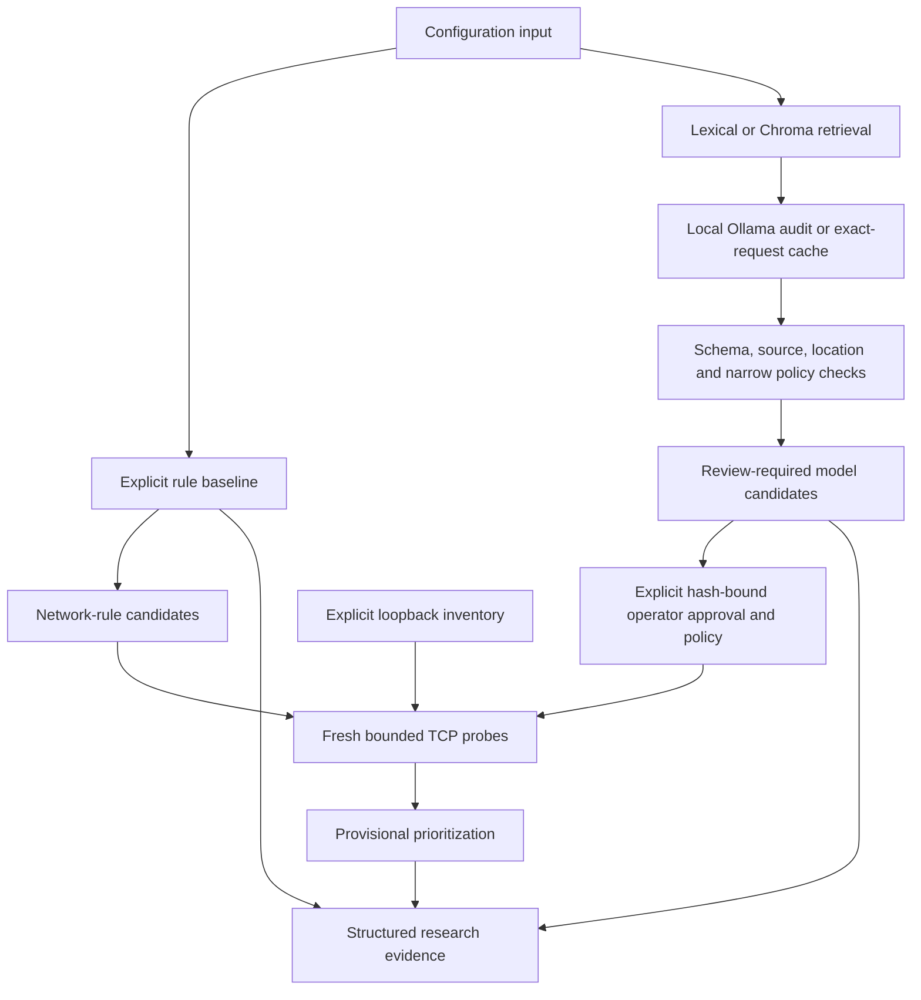

<div align="center">

# Active Cloud Guard

Latest reproducibility qualification: [isolated patched dependency candidates](docs/DEPENDENCY_CANDIDATE_QUALIFICATION.md), with separate candidate inventories and cross-platform checks. Historical environments and locks remain unchanged; optional-vector qualification/default promotion, independent evaluation and production acceptance remain open.

Current readiness refinement: [bounded legacy inputs and client subprocesses](docs/LEGACY_RUNNER_BUDGETS.md), with partial failure evidence and explicit remote-job uncertainty. No Docker/model/sensor experiment or production readiness is inferred from passing software checks.

Next-stage readiness: [sequenced production/research acceptance roadmap](docs/PRODUCTION_RESEARCH_ROADMAP.md). [Model envelope rejection](docs/MODEL_ENVELOPE_VALIDATION.md) is implemented; genuine independent evaluation, novelty and production acceptance remain separate open gates.

Current maintenance: [research completion status and evidence-safe runner interfaces](docs/RESEARCH_COMPLETION_STATUS_20261009.md). Legacy experiment scripts require fresh output paths; environment capture no longer overwrites the lockfile. Selected resource boundaries are hardened, while independent approval/data/runtime qualification and measured effectiveness remain open.

### Evidence-linked configuration auditing for cloud-hosted open-source software

Honors research · Engine 1 v2.2 · Engine 2 replay foundation · Package 0.5.0

Latest [engine/security/research audit](docs/ENGINE_AUDIT_20261009.md) fixes local-model port/redirect confinement and documents original-plan alignment and open gaps. Full regressions: Linux1,448pass / Windows1,410pass38existing skips. Focused local audit/software evidence—not exhaustive security certification, independently validated detection or production readiness.

Reproducibility maintenance: [development evaluator evidence preservation](docs/EVALUATOR_EVIDENCE_PRESERVATION.md) requires `python scripts/evaluate.py --output output/NEW_FILENAME.json`, preserving historical reports and failed runs without changing detector calculations. Development fixtures remain distinct from independent research data.

Latest validation: **1,372 passed / 38 existing skips in the full Windows suite**, plus ten evaluator cases and a fresh45-case development run passed on each OS. Full Linux not rerun for this script-only fix; historical report/calculated results preserved and current bindings checked.

Evaluation preparation: [matched synthetic decision accounting](docs/SYNTHETIC_PAIRED_ACCOUNTING.md) checks exact populations and preserves coverage, abstentions, unknowns and undefined rates when comparing variants. Software arithmetic only—not model predictions, an executed ablation study or independent effectiveness evidence.

Latest verification: **1,362 passed / 38 existing skips in the full Windows suite**, plus **94 relevant accounting tests passed on each of Windows and Linux**. No full Linux rerun for this isolated addition; older full-suite counts below remain historical checkpoints.

Latest processing refinement: [single-pass comparator indexing](docs/INTEGRATION_WINDOW_INDEX.md) avoids repeatedly filtering all runtime windows per asset while preserving report evidence. Verified by deterministic row-visit tests and legacy-report comparisons; no measured energy or independent effectiveness claim.

Latest full regression verification: **1,352 passed on Linux; 1,314 passed / 38 existing skips on Windows**. Includes all six new indexing/equivalence cases. Older milestone counts below are historical software checkpoints, not additional attack scenarios.

Efficiency instrumentation: [opt-in integration execution cost](docs/INTEGRATION_EXECUTION_COST.md) records local elapsed/process CPU per executed stage and total while preserving detector evidence. Synthetic software observations only; matched sensor overhead, energy and independent performance validation remain pending.

Latest whole-repository software verification: **1,346 passed on Linux; 1,308 passed / 38 existing skips on Windows**, with all final instrumentation/CLI/launcher code included. These counts are regression evidence, not independent attack scenarios or performance qualification.

Latest engineering milestone: [synthetic runtime ML integration](docs/SYNTHETIC_ML_INTEGRATION.md) connects the existing Isolation Forest and autoencoder to both integration modes, preserving separate scores and abstentions. Full Windows1284pass38skip/Linux1322pass before final launcher test; corrected final integration target79pass. Actual synthetic demonstrations passed on both systems. This is software evidence, not independently evaluated detection effectiveness.

**Current status — 7 October 2026:** [capabilities and research gates](docs/CURRENT_STATUS.md). Engine 1's preserved v2.2 baseline has subsequent cache/parser maintenance. Engine 2 implements saved statistical replay and separate bounded Falco acquisition/normalization; optional ML comparators have synthetic validation. [Integrated replay](docs/INTEGRATED_REPLAY.md) now supports an explicit [existing Engine1 pipeline mode](docs/PIPELINE_RUNTIME_INTEGRATION.md), retaining retrieval/model/probe/policy/priority evidence beside runtime context. Missing evidence and abstentions remain visible. Python/CLI, Docker Compose, Ollama and Chroma remain the stack.

Latest software verification: **Linux 1,306 passed; Windows 1,268 passed / 38 skips**, zero failures/errors (37 Linux-only; one host symlink-privilege skip). [Linux receipt](output/pipeline-integration-full-linux-tests-20261007.xml) / [Windows receipt](output/pipeline-integration-full-windows-tests-20261007.xml). Twenty-eight new pipeline-integration cases and matching eight-check examples cover this extension. The fixed example performs actual local retrieval/scoring without model/TCP; those paths are tested with mocks. Independent effectiveness, calibrated scoring and continuous live integration remain open. [Beginner guide](<docs/Progress Execution.md>).

Optional [Isolation Forest](docs/SYNTHETIC_RUNTIME_ML.md)/[autoencoder](docs/SYNTHETIC_RUNTIME_AUTOENCODER.md) retain synthetic validation and uncalibrated scores; [decision accounting](docs/SYNTHETIC_RUNTIME_ACCOUNTING.md) uses invented decisions. A [historical Windows import failure](output/engine2-accounting-windows-tests-20261007.xml) remains causally unresolved (INC-056), with [safe backend diagnostics](docs/RUNTIME_ML_BACKEND_DIAGNOSTICS.md) implemented for future failures. Prior negative evidence is preserved. The [review pack](docs/RUNTIME_LABELING_PROTOCOL.md) remains **unapproved**; qualified data/timing/coverage/context, independent humans/calibration/effectiveness/overhead remain research gates.

Next research step: the [existing runtime-data audit](docs/RUNTIME_DATA_READINESS_AUDIT.md) verifies seven saved normalized captures but establishes no independent benchmark. The [supervisor-ready evaluation proposal](docs/ENGINE2_SUPERVISOR_REVIEW_PROPOSAL.md) is **DRAFT — NOT APPROVED**; the owner confirmed approval has not been obtained. Review the proposed target/context, collection qualification, independent humans, grouped evaluation and analysis before real-data study work. No source/algorithm/data or service/clock change in this audit.

For a concise current handoff read [MEMORY](docs/MEMORY.md); earlier content is preserved as an exact [historical snapshot](docs/MEMORY_HISTORY_20261007.md). Historical experiments remain linked with their original scope; the current integration capability and test receipts are described above.

<details>
<summary>Historical checkpoint summaries — not the current task list</summary>

The dated statements below retain their checkpoint meaning; use CURRENT_STATUS above for present capability/priority. Later native synthetic callback and inert durable gate refinements are documented in the [evidence index](docs/EVIDENCE.md).

Latest live engineering observation (6 October 2026): after explicitly authorized Docker Desktop recovery, the [read-only receiver check](docs/SYSTEMD_RECEIVER_CAPTURE.md) completed once with notification registration, identity continuity, release/close and child reaping checks passing. 50 process calls, **0 selected completion events**: this validates bounded setup/cleanup, not native event delivery, job fencing or timing/ML. No time-service/clock setting or default-engine/source change. Actual minimized receipts and the earlier failed precheck are preserved.

Earlier execution gate (6 October 2026): the [Docker availability/sensor-inventory precheck failed](docs/SYSTEMD_RECEIVER_CAPTURE.md), so no native receiver was launched at that checkpoint. The expected local engine/integration was subsequently recovered with explicit user-authorized Desktop startup; the failed evidence remains unchanged. This does not establish why Desktop was previously unavailable or a research clock cause.

Latest software check (implementation checkpoint, 6 October 2026): **Windows 755 tests passed/5 Linux-only skips; Linux 760 tests passed**. The [exclusive read-only receiver launcher](docs/SYSTEMD_RECEIVER_CAPTURE.md) preserves start/outcome records and adds bounded supervision/source/schema guards. 34 new cases include two actual inert Linux child tests, not service operations. Native observation was pending at that checkpoint and subsequently completed as reported above. Engine 1 and existing stack are unchanged; job fencing, timing reliability and independent ML evaluation remain open.

Previous receiver checkpoint (6 October 2026): Windows723tests passed/3Linux-only skips; Linux726tests passed. The [isolated read-only systemd receiver](docs/SYSTEMD_RECEIVER.md) adds54synthetic/C-level regressions and verified installed-library ABI/exports. Real notification reception and durable job/fence integration remain unverified; no subscription or service-control operation executed in that milestone. This is research safety instrumentation, not a clock fix, validated anomaly model or production readiness.

Previous checkpoint (E2-032, 6 October 2026): Windows669tests passed/3Linux-only skips; Linux672tests passed. [Systemd job-evidence review/contract](docs/SYSTEMD_JOB_CONTRACT.md) adds actual read-only interface checks and synthetic completion matching; it grants no recovery authority. The [isolated inert guest fence](docs/GUEST_FENCE_PROTOTYPE.md) is not connected to native operations. [Uncertain stop-delivery guards](docs/CLOCK_STOP_DELIVERY.md) prevent premature recovery cancellation after a simulated failure; [preflight source checks](docs/CLOCK_COMPARISON_PREFLIGHT.md) cover23local files. The proposed new time-service intervention/comparison batch has not run; the earlier separately approved [E2-007 temporary test](docs/TIME_SYNC_DIAGNOSIS.md) remains historical evidence, not current consent. Native bus/job/fence binding, approval/final protocol/restoration validation remain pending. Engine 2's earlier live diagnostic sampled changing kernel tick/frequency settings alongside a RAW/MONO elapsed gap (~0.463 s) and wall/boot relationship change (~0.867 s). Timing reliability and causal attribution remain unresolved; independent runtime ML and general accuracy/overhead are not established. See the [latest live diagnostic](docs/KERNEL_CLOCK_STATE.md), [evidence index](docs/EVIDENCE.md), and beginner-friendly [Progress Execution guide](<docs/Progress Execution.md>).

Latest read-only review: [synchronization writers](docs/SYNC_WRITER_REVIEW.md). Guest-service removal alone cannot establish a single clock authority or clear accumulated rate settings. A temporary before/stopped/restored comparison is proposed, not authorized or executed; current engine architecture and settings remain unchanged.

Windows-hosted Linux setup and Docker integration are verified. No known research sensor was present at the latest pre/post diagnostic checks; no clock or service settings were changed. See the [WSL setup record](docs/WINDOWS_LINUX_SETUP.md).

</details>

[Research protocol](docs/EXPERIMENT_PROTOCOL.md) · [Architecture](docs/ARCHITECTURE.md) · [Evidence](docs/EVIDENCE.md) · [Documentation](docs/INDEX.md)

</div>

---

## Abstract

Active Cloud Guard investigates how configuration analysis, retrieval-assisted local language models, and controlled network observations can support security review of cloud-hosted open-source software. The prototype separates three concepts: a configuration-level candidate, observed reachability from a specified vantage point, and an actionable vulnerability.

The implementation combines a transparent rule baseline, source-backed retrieval, structured local-model auditing, and explicit staging probes. Engine 1 v2 adds bounded response reuse, reusable vector indexing, generation controls, and stage-level timing. This repository includes development fixtures, reproducibility scripts, raw observations, negative model results, and a documented evaluation protocol.

V2.1 adds hash-bound operator policies and reviewed model-to-endpoint verification. Approved candidates receive scoped TCP evidence—not automatic vulnerability confirmation or scoring. Read the [refinement report and operator workflow](docs/ENGINE1_REFINEMENT.md).

V2.2 adds actual-Compose local deployment identity checks and credential-free Redis/PostgreSQL observations. Both were exercised against the existing loopback lab. See the [baseline report, commands and limitations](docs/ENGINE1_BASELINE.md).

Engine 1 is preserved under Git tag `engine1-v2.2`. Engine 2 has an **observation-only replay foundation**: normalized events, time-window features and a simple statistical comparator, demonstrated synthetically rather than as validated ML. Separate live Falco/Redis capture and timing instrumentation have been exercised, but timing stability remains unresolved; those diagnostics are not independent detection benchmarks. See the [foundation](docs/ENGINE2_FOUNDATION.md), [instrumentation](docs/ENGINE2_INSTRUMENTATION.md) and [current state](docs/MEMORY.md).

**Research status:** implemented, software-tested and live-smoke-observed. Independent effectiveness evaluation remains pending. This is a research prototype—not a production security control or a claim of validated vulnerability prevention.

| Project | Details |
|---|---|
| Researcher | Manish Patil |
| Proposal | *An Active AI Security Layer for Misconfiguration & Exposure Prevention in Cloud-Hosted Open-Source Software* |
| Current scope | Frozen Engine 1 baseline; implemented Engine 2 replay, separate telemetry/refinements and open runtime research gates |
| Execution | Local Python CLI/library; Docker Compose, Ollama and Chroma |
| Evidence snapshot | 6 October 2026: Linux 854 passes; Windows 817 passes / 37 Linux-only skips. Fresh synthetic scope-reporting replay, unchanged calculations. Historical native setup/cleanup (0 events) and later native synthetic/inert gate checks are not independent detection research; [current summary](docs/CURRENT_STATUS.md) |
| Evaluation data | 45 synthetic development cases; **not an independent test set** |

## Research questions

1. **Retrieved context:** does security-context retrieval improve finding-level precision and recall relative to the same local model without retrieval?
2. **Verification:** can scoped verification improve prioritization without concealing false negatives or unsupported conclusions?
3. **Runtime evidence, later work:** what additional value and overhead would runtime observations provide?

These are questions to be evaluated, not established results. The [experimental protocol](docs/EXPERIMENT_PROTOCOL.md) defines independent annotation, grouped data separation, matched comparisons, abstention handling and uncertainty reporting. The [literature audit](docs/LITERATURE.md) distinguishes verified sources from references requiring further review.

## System architecture



Model candidates remain separate from rule findings. They do not execute commands, choose probe destinations, or automatically trigger remediation. A TCP connection is reachability evidence, not proof of authentication bypass or Internet exposure. See the [architecture](docs/ARCHITECTURE.md) and [security boundaries](docs/SECURITY.md).

### Implemented capabilities

| Component | Present implementation | Boundary |
|---|---|---|
| Configuration baseline | Nine explicit predicates across selected Compose, Kubernetes, Terraform, Dockerfile and service-configuration constructs | Not a general IaC evaluator |
| Knowledge retrieval | Nine summaries with official-source provenance; lexical and Chroma retrieval | Source membership does not establish entailment |
| Local-model auditing | Ollama, structured JSON, exact-location checks and two narrow authentication-policy guards | All candidates require human review |
| Active verification | Loopback TCP plus identity-gated Redis PING/PostgreSQL startup | No supplied credentials, data access, exploitability or public-exposure validation |
| Prioritization | Monotonic provisional scoring; missing evidence remains explicit | Weights are not empirically calibrated |
| V2 efficiency | Opt-in exact-request cache, index reuse, generation limits and stage timings | Repeat-work optimization, not demonstrated energy savings |

The local testbed contains Redis, PostgreSQL, Nginx and MinIO, with Ollama as the model service. Engine 2 supports count-deviation replay, a separate bounded Falco/eBPF harness/offline adapter, and optional synthetic-only Isolation Forest and reconstruction-autoencoder software paths. Sensor-clock alignment/complete coverage remain unresolved. Kubernetes collection, independently evaluated real-data runtime ML, autonomous isolation and production deployment are not implemented.

## Results and evidence

### Software and integration evidence

| Observation | Evidence | Interpretation |
|---|---|---|
| 301 software tests on each OS | [Windows](output/engine2-call-clocks-windows-tests-20260930.xml), [Linux](output/engine2-call-clocks-linux-tests-20260930.xml) | Regression checks, not detection accuracy |
| Engine 2 constructed count deviation | [Synthetic replay report](output/engine2-replay-smoke.json) | No live sensor or independent threat labels |
| Stable identity and service observations | [V2.2 live lab report](output/service-identity-v22-final.json) | Redis protected-mode denial and PostgreSQL SASL challenge; no full attestation |
| Policy-aware real loopback observations | [V2.1 smoke report](output/verification-v21-smoke.json) | Synthetic policies and accept-only listener; no deployment or model claim |
| 45 development fixtures matched expected rule sets | [Development baseline](output/baseline-development.json) | Seeded-predicate coverage, not generalization |
| Four local TCP accepts and two HTTP 200 responses | [Historical lab observation](output/live-testbed.json) | Time- and vantage-specific availability |
| Vector retrieval and integrated model/probe execution | [Vector smoke](output/vector-smoke.json), [integrated run](output/integrated-demo.json) | Historical functional observations |
| Trivy executed on 11 compatible fixtures; 34 excluded | [Trivy baseline](output/trivy-baseline.json) | Different policy coverage; not a head-to-head accuracy result |

### Engine 1 v2: repeat-work efficiency

These measurements come from **one development fixture**, executed sequentially on the recorded Windows environment with `qwen2.5:3b` and `nomic-embed-text`. Pipeline runs used lexical retrieval; index timings are separate operations.

| Operation | Observed wall time | Work performed |
|---|---:|---|
| Forced vector-index build | 5.804 s | Nine documents embedded |
| Unchanged index reuse | 0.084 s | Zero documents embedded |
| First uncached pipeline | 17.424 s | Fresh generation and TCP probe |
| Warm cache-miss pipeline | 5.256 s | Fresh generation and TCP probe |
| Cache-hit pipeline, repeat 1 | 0.084 s | Revalidated cached output; fresh TCP probe |
| Cache-hit pipeline, repeat 2 | 0.072 s | Revalidated cached output; fresh TCP probe |

Source: [raw v2 observation](output/v2-efficiency-smoke.json). Conditions, identities and metric semantics: [Engine 1 v2 design](docs/ENGINE1_V2.md).

Cached candidates were preserved and probes received new timestamps. These observations establish functional reuse on this input; they do **not** establish a latency distribution, a matched v1 improvement, or energy/carbon savings. The 3.5-second uncached inference target remains unmet.

### Negative results and validity limits

- **Model reliability:** earlier runs produced malformed output and unsupported claims. Both [initial failures](output/rag-smoke-initial-failures.json) and [unsupported candidates](output/rag-smoke-ungrounded-candidates.json) are retained.
- **Limited guards:** the 3B model inferred trust authentication from a password placeholder. The [pre-guard observation](output/rag-smoke-3b-before-policy-guard.json) remains available. Narrow guards mitigate known predicates; hallucinations are not generally solved.
- **Data leakage risk:** prompts and model choices were tuned on development cases. These cases cannot subsequently be described as untouched evaluation data.
- **Coverage:** no general Terraform evaluation, Helm rendering, comprehensive secret detection or role-binding graph is implemented. Unsupported cases must not disappear from evaluation denominators.
- **External validity:** no independently labeled effectiveness study, calibrated prioritization or production-safety assessment is claimed. Linux sensor validation is limited to the documented bounded smoke trial.

An empty candidate list is not a security certification. A rejected model candidate is an abstention, not a clean verdict. The [evidence index](docs/EVIDENCE.md) distinguishes current v2 artifacts from historical observations; the older [results ledger](output/RESEARCH_STATUS.md) is not a v2 summary.

## Reproducibility

Optional installed-package validation: [local wheel qualification](docs/PACKAGE_QUALIFICATION.md) covers actual Windows/Linux minimized builds and selected offline entry-point functions without source imports. It reuses portable dependencies, not a fresh-host or optional-vector certification. Default setup below remains source-tree execution.

### 1. Prepare the environment

Prerequisites: repository access, Python 3.11+, and Git. Portable core/ML source-tree checks were qualified on Windows Python 3.12.14 and WSL Linux Python 3.12.3; macOS and other versions remain unqualified. Docker with Linux-container support and several GB of image/model downloads are needed only for separately authorized live experiments.

From the repository root, create a **new** ignored environment. These commands refuse an existing destination rather than changing a historical environment. Choose a different fresh name if necessary.

**Windows PowerShell**

```powershell
if (Test-Path -LiteralPath tmp/core-current-new) { throw 'Choose a fresh environment directory' }
python -m venv tmp/core-current-new
.\tmp\core-current-new\Scripts\Activate.ps1
```

**Linux shell — macOS remains setup guidance only**

```bash
test ! -e tmp/core-current-new || { echo 'Choose a fresh environment directory'; exit 1; }
python3 -m venv tmp/core-current-new
source tmp/core-current-new/bin/activate
```

Install the hash-pinned installer, then the recommended source-tree profile. This profile includes optional synthetic ML checks, **not Chroma**; neither engine's detection logic changes. No editable/package build is implied by source-tree execution.

```bash
python -m pip --isolated install --index-url https://pypi.org/simple --only-binary=:all: --no-deps --require-hashes --disable-pip-version-check --no-input -r requirements-remediation-bootstrap-20261009.txt
python -m pip --isolated install --index-url https://pypi.org/simple --only-binary=:all: --disable-pip-version-check --no-input --retries 0 --resume-retries 0 --timeout 20 -r requirements-core-current.txt
python -m pip check
python scripts/core_profile_check.py --output output/core-current-new-profile.json
python scripts/dependency_candidate_check.py --output output/core-current-new-smoke.json
git config core.hooksPath .githooks
```

The smoke requires a fresh output filename. [Profile promotion and limits](docs/CORE_PROFILE_PROMOTION.md) distinguish this recommended setup from untouched working environments. The commit hook may still select the historical `.venv`; configuring the hook does not upgrade it.

The [historical lockfile](requirements-lock.txt) is an evidence snapshot, **not the recommended installation**: it retains known advisory matches. The [full optional candidate](requirements-remediation-windows-candidate-20261009.txt) remains incompletely qualified. Chroma is still part of the architecture, but vector commands below require a separately reviewed optional environment; omission from the portable profile is not remediation. Do not expose a Chroma server or treat these snapshots as production guidance. The [historical environment report](output/environment.json) records earlier image/model identities; v2 model/corpus digests are in its raw observation.

### 2. Run software checks and a model-free scan

```bash
python -m pytest -q --basetemp=tmp/core-current-tests-new -o cache_dir=tmp/core-current-cache-new
python -m pip check
python -m cloudguard.cli scan data/development/postgres-trust.yaml
python -m cloudguard.cli retrieve "PostgreSQL trust authentication"
python scripts/repository_check.py
```

These commands do not require the live Docker lab. The 45 development fixtures are already versioned; rebuilding them is not required for a first inspection. Lint/format commands and experiment prerequisites are documented in the [test plan](docs/TEST_PLAN.md).

### 3. Start the controlled lab and local models

Optional-vector/live path only: **not available in the portable profile**. Full optional dependency qualification and explicit operational authorization remain prerequisites; the following is historical research guidance, not an instruction to start workloads during setup.

```bash
python scripts/init_secrets.py
docker compose -f testbed/compose.yaml --profile ai up -d
docker compose -f testbed/compose.yaml exec -T ollama ollama pull qwen2.5:3b
docker compose -f testbed/compose.yaml exec -T ollama ollama pull nomic-embed-text
python -m cloudguard.cli index
```

Model tags can resolve to different artifacts over time. Compare downloaded digests with the saved report before claiming matched reproduction. Pinned historical container versions support reproducibility; they are not a recommendation for production deployment.

### 4. Audit, verify and measure

```bash
python -m cloudguard.cli run data/development/redis-all.yaml --inventory testbed/inventory.json --model qwen2.5:3b --cache-dir output/audit-cache --max-tokens 512 --timeout 180
python -m cloudguard.cli probe --inventory testbed/inventory.json --asset compose/redis
python scripts/benchmark_v2.py --output output/v2-new-run.json
```

Repeat the `run` command to observe exact-request reuse. Omit `--cache-dir` for fresh generation; add `--vector-index output/chroma` for semantic retrieval. Use `index --force` to rebuild embeddings. The timeout is an HTTP socket timeout, not a total workflow deadline or guaranteed cancellation of server work.

The benchmark requires a **new output filename** and preserves partial observations on failure. Do not overwrite committed evidence. Older evaluation scripts may write fixed report paths; run them only in a separate experimental checkout or after explicitly arranging evidence preservation. Consult the [test plan](docs/TEST_PLAN.md) before reproducing historical experiments.

Stop the lab without deleting model volumes:

```bash
docker compose -f testbed/compose.yaml --profile ai stop
```

### Lab safety and data handling

All published ports bind to `127.0.0.1`: Redis `16379`, PostgreSQL `15432`, Nginx `18080`, MinIO `19000`, and Ollama `11434`. The dedicated bridge is **not egress-isolated**. Only use explicitly authorized local endpoints; intentionally weak fixtures are analysis inputs, not deployment recipes.

PostgreSQL/MinIO data are disposable; Redis persistence is disabled. Credentials, model weights, vector databases and audit caches are not committed. Generated cache content can repeat sensitive input: use a trusted local directory and preserve exclusions. See [security policy](docs/SECURITY.md) for the complete boundaries.

## Engine 2: observation-only replay

```bash
python -m cloudguard.cli runtime-replay data/runtime/observation-synthetic.json --baseline data/runtime/baseline-synthetic.json --inventory testbed/inventory.json
python scripts/runtime_check.py --output output/engine2-new-replay.json
```

This opens no network connection and executes no response action. The fixtures contain invented timestamps and a placeholder container ID. Missing windows remain unknown; deviations require review and are not attack probabilities. Live sensor integration, trusted identity mapping, independent runtime labels and ML comparison are next gates, not implied capabilities. Read the [contract and limitations](docs/ENGINE2_FOUNDATION.md).

## Repository guide

| Location | Purpose |
|---|---|
| [cloudguard/](cloudguard/) | Parser/rules, retrieval, local audit, cache, probes, scoring and CLI |
| [tests/](tests/) | Software regression and boundary checks |
| [data/](data/) | Synthetic development fixtures and labels |
| [knowledge/](knowledge/) | Source summaries and provenance |
| [testbed/](testbed/) | Docker lab and explicit endpoint inventory |
| [scripts/](scripts/) | Reproduction, measurement and publication checks |
| [output/](output/) | Reviewed observations, failures and test reports |
| [docs/](docs/INDEX.md) | Protocol, design, evidence, decisions and maintenance history |

## Research roadmap

The next scientific milestone is independent evaluation:

1. Obtain independent reviewer labels and an untouched, grouped evaluation set.
2. Run matched rule-baseline, local-model and retrieval-assisted comparisons with coverage and abstentions reported.
3. Evaluate evidence-linked prioritization, false negatives and uncertainty under an agreed threat model.
4. Measure unseen-input latency, CPU/memory and power before making broader efficiency or sustainability claims.
5. Extend the Engine 2 replay foundation with validated Linux sensor capture, coverage accounting and independently evaluated runtime models.

The [task ledger](TASKS.md) records completed engineering work, partial research work and deferred milestones. Engineering completion is not equivalent to validating the research hypothesis.

## Review, attribution and maintenance

For review, begin with the [protocol](docs/EXPERIMENT_PROTOCOL.md), [evidence index](docs/EVIDENCE.md), [decision register](docs/DECISIONS.md) and [incident ledger](docs/INCIDENTS.md). Changes follow the [documentation maintenance contract](docs/DOCUMENTATION_WORKFLOW.md): record what changed, why, exact checks, failures and remaining limits. The commit guard runs locally; no hosted CI result or peer-review endorsement is implied.

When referring to this software in an internal report, identify **Manish Patil, Active Cloud Guard, package version 0.5.0**, the exact Git commit and the specific evidence artifact used. This is software attribution guidance, not a publication citation; no DOI is claimed.

The repository is private. No open-source license has been selected; access does not itself grant redistribution rights. Contact the repository owner before external reuse or publication of project materials.
